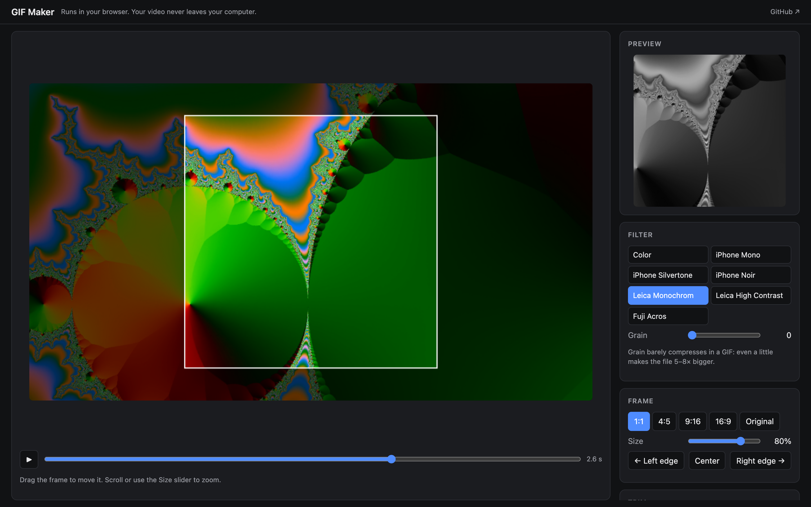
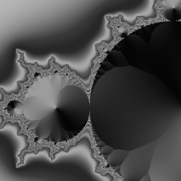

<div align="center">


# GIF Maker

**Crop, trim, tone. Nothing else.**

Turn a video, a GIF or a photo into a sharp GIF, MP4, WebM or Telegram sticker right in your browser:<br>
crop it to 1:1, cut the moment you want, lift a dark clip, give it a black-and-white film look. Nothing is uploaded.

[](https://github.com/vekaev/gif-maker/actions/workflows/ci.yml)
[](https://vekaev.github.io/gif-maker/)
[](index.html)
[](LICENSE)
[](#status)

<br>

[](https://vekaev.github.io/gif-maker/)

<sub>Free, no sign-up, no install. Works best in Chrome or Edge on a computer.</sub>

<br><br>



<sub>The demo clip is a generated Mandelbrot zoom, shown in Before / After with the Leica Monochrom look.</sub>

<p>
  <a href="#features">Features</a> ·
  <a href="#formats">Formats</a> ·
  <a href="#black-and-white-looks">B&amp;W looks</a> ·
  <a href="#why-it-looks-clean">Quality</a> ·
  <a href="#telegram">Telegram</a> ·
  <a href="#get-started">Get started</a> ·
  <a href="#privacy">Privacy</a>
</p>

</div>

## Features

- **Video, GIF or photo in.** MP4, MOV, WebM and anything else your browser plays; animated GIF, WebP or
  PNG (each frame keeps its own timing); or a photo, which becomes a 3-second clip. So a GIF you already
  edited elsewhere can become a Telegram sticker or an MP4.
- **See the result big, or side by side.** **Crop** shows the whole frame with the crop box. **Result**
  fills the main area with the finished picture (drag it to move the crop). **Before / After** puts the
  original on the left and the result on the right of a line you drag.
- **One button at the top.** Pick the format, press **Download**: the header shows what's happening and
  the file lands in your Downloads folder as soon as it's ready.
- **Crop to any shape.** 1:1, 4:5, 9:16, 16:9 or the original. Drag the frame, scroll to zoom, or snap it to
  the left edge, the center or the right edge in one click. Everything outside the frame dims, so you see
  exactly what you'll get.
- **Trim like in QuickTime.** A filmstrip under the picture with a yellow frame: drag its handles to set
  the start and end (the big view shows the frame under the handle), drag the yellow bar on top to slide the
  whole clip, click anywhere to jump. **Space** plays and pauses. The preview loops only the clip.
- **Speed it up, all of it or just a part.** One slider for the whole clip (⅛× to 16×). **＋ Speed up a
  part** adds a faster stretch at the playhead, shown as a blue band on the timeline with its own speed.
  The preview plays at those speeds, and the export follows them frame by frame.
- **Fix the light.** Exposure, Shadows, Contrast, Saturation and Warmth, each going both ways from a
  centred zero (double-click a slider to reset it), live as you drag. **✨ Auto** lifts
  a dark clip so the highlights sit near white and the midtones open up. **Reset** puts it all back.
- **Black-and-white film looks.** Six of them: iPhone Mono, Silvertone and Noir, Leica Monochrom and Leica
  High Contrast, Fuji Acros. Plus optional grain.
- **Four formats.** GIF by default, or MP4, WebM and a ready-to-send Telegram video sticker. See
  [Formats](#formats).
- **Your exports stay at hand.** Every file you make is also kept in **Recent downloads** with a thumbnail,
  its size and time. Download any of them again later, even after a reload, or remove the ones you don't need.
- **Room to look.** Drag the edge of the side panel to make it, and the preview in it, as big as you want.
- **Full quality.** Frames come from the video at its original resolution and are scaled down once, with
  high-quality smoothing. It never upscales: ask for more pixels than the crop has and it tells you.
- **Fast.** Frames are decoded once, in order, with WebCodecs instead of seeking for each one: a 7.5-second
  2880×1620 HEVC screen recording became a 600 px GIF in 2 s instead of 12 s. GIF encoding runs in a
  background worker and the preview only redraws when something changed, so the tab doesn't freeze.

## Formats

| Format | Best for | Notes |
|---|---|---|
| **GIF** | Anywhere that only takes GIFs | Up to 256 colours, so files are the biggest. Up to 1920 px, up to 50 frames/s. |
| **MP4** (H.264) | Telegram, iMessage, WhatsApp, the web | Full colour, small files, plays everywhere. Adds a silent sound track by default so Telegram sends it as a video, not a GIF. |
| **WebM** (VP9) | The web, Discord | Full colour, small files. Optional silent Opus track. |
| **Telegram sticker** | Telegram video stickers | WebM VP9, 512 px on the longer side, up to 3 s, no sound, under 256 KB: the size is checked and the bitrate stepped down until it fits. If the clip plays longer than 3 s, the part that won't make it in is hatched red on the timeline, and **Fit into 3 s** speeds the clip up so all of it fits. |

MP4 and WebM are encoded with your browser's own video encoder (WebCodecs). If a browser can't encode a
format at that size, the app says so instead of producing a broken file.

## Black-and-white looks

Each look turns colour into grey its own way (like a coloured filter in front of the lens) and has its own
tone curve:

| Look | What it does |
|---|---|
| **iPhone Mono** | Plain, neutral black and white. |
| **iPhone Silvertone** | Brighter, a little more contrast, a faint cool silver in the midtones. |
| **iPhone Noir** | Deep blacks, clipped whites, hard contrast; blues go dark. |
| **Leica Monochrom** | Neutral and wide-ranged, with a gentle S-curve. |
| **Leica High Contrast** | Punchy, with rich blacks. |
| **Fuji Acros** | Acros with a yellow filter: darker skies, glowing skin, rich shadows. |

These are approximations made by eye. Apple, Leica and Fujifilm don't publish their recipes.

<p align="center">
  
  <br>
  <sub>A real export: Leica Monochrom, 360 px, 12 frames/s, 3 s, 2.3 MB.</sub>
</p>

**Grain** is a separate slider and starts at zero. In a GIF, grain barely compresses: even a little makes
the file 5–8× bigger. In MP4 and WebM it costs far less.

## Why it looks clean

GIFs made in the browser often show contour lines on skin and walls, and blotches that crawl from frame to
frame. GIF Maker avoids both:

- **One palette for the whole clip.** It samples frames across the clip and builds a single 256-colour
  palette, so colours don't jump between frames.
- **Exact colour matching.** Each pixel goes to its truly nearest palette colour. The usual shortcut rounds
  colours to 32–64 levels per channel first, which is what draws the contour lines.
- **Ordered dithering.** An 8×8 Bayer pattern smooths gradients. Unlike error diffusion it stays still from
  frame to frame, so there's no "boiling" noise. Turn it off for a smaller file.
- **All 256 greys for black and white.** B&W looks use every grey level instead of a quantized palette, so
  there's no banding at all.
- **Exact timing.** GIF delays are whole hundredths of a second. The delays alternate, so a 4-second clip
  stays 4 seconds at any frame rate.

## Telegram

- **As a GIF:** export **GIF** or **MP4** without the sound track and send it. Telegram stores GIFs as
  silent MP4s anyway, so the MP4 looks better and is smaller.
- **As a video:** export **MP4** with **Silent sound track** on (the default). Telegram sends a video with
  a sound track as a regular video.
- **As a sticker:** export **Telegram sticker**, then send the file to [@Stickers](https://t.me/stickers)
  with `/newvideo` (a new video pack) or `/addsticker` (into a video pack you made with `/newvideo`).
  Sending the .webm straight into a chat, or into a pack made with `/newpack`, gives a still picture or
  "Invalid file type": those packs take only static PNG/WEBP. Requirements are in
  [Telegram's guide](https://core.telegram.org/stickers/webm-vp9-encoding). Sticker packs can be opened by
  anyone with their link.

## Get started

Open **[vekaev.github.io/gif-maker](https://vekaev.github.io/gif-maker/)**, drop a video on the page and
press **Download GIF**.

Or run it from your own copy. It's a single HTML file, no build step:

```bash
git clone https://github.com/vekaev/gif-maker && cd gif-maker
open index.html            # or double-click it
```

It works opened straight from disk too.

## Under the hood

One `index.html`, plain JavaScript, no framework.

- **Decoding:** the browser's `<video>` element for the preview, so anything your browser plays works (MP4,
  MOV, HEVC, WebM…); exports decode in order with WebCodecs through
  [mediabunny](https://github.com/Vanilagy/mediabunny). GIFs and animated images go through `ImageDecoder`.
- **GIF:** [gifenc](https://github.com/mattdesl/gifenc) writes the file. Palette mapping, dithering and the
  colour pipeline are custom, and run in a Web Worker.
- **MP4 / WebM:** [WebCodecs](https://developer.mozilla.org/docs/Web/API/WebCodecs_API) encodes, and
  [mp4-muxer](https://github.com/Vanilagy/mp4-muxer) and [webm-muxer](https://github.com/Vanilagy/webm-muxer)
  package the result.
- **Exports list:** IndexedDB, in your browser only.

## Privacy

Your files never leave your computer: they're read, processed and encoded on the page. The only network
requests load the libraries above from jsDelivr. Exports are kept in this browser's storage until
you remove them or clear site data. No analytics, no cookies, no accounts.

## Development

The app itself needs nothing installed. The tests need Node 22+ and Google Chrome.

```bash
npm install                # Playwright, http-server, husky (and the git hooks)
npm start                  # http://localhost:4173
npm test                   # quick checks + the end-to-end suite
npm run test:e2e:ui        # the suite in Playwright's UI
```

The **end-to-end suite** (`e2e/`, Playwright, Google Chrome) drives the real page with small generated
clips in `e2e/fixtures` and checks the actual output files, not just the UI:

- **Sources:** MP4, WebM, an animated GIF (right frame at each moment), a photo, drag and drop, switching
  files, and a clear message for a file that isn't a video.
- **Views:** Crop, Result and Before / After; the result fills the main area in the crop's shape; the
  before side stays in colour and the after side follows the look as you drag the line.
- **Crop:** every aspect, snapping to the edges (by the colours that end up in the frame), dragging,
  zooming, no upscaling, the dimmed outside.
- **Trim:** dragging the timeline handles (and seeing that frame), sliding the clip by its bar, clicking to
  jump, the filmstrip, Space, the sliders, **Start here / End here**, and that the preview loops inside.
- **Speed:** the whole clip at 2× (half as long, every moment still in it), a 4× part that shortens only
  itself (checked frame by frame in the GIF), the preview's playback rate, editing and deleting parts,
  the sticker's red overflow and **Fit into 3 s**, and that GIFs have no 3 s limit.
- **Light and colour:** each slider changes the right pixels, **Auto** lifts a dark clip, **Reset**. All
  six B&W looks come out grey and clearly different from each other, and grain adds noise.
- **GIF:** frame count, size, exact length, that the right moments are in it (a fade's brightness frame by
  frame, with no steps), colour settings baked in, all-grey B&W, dithering, the 50 frames/s cap, encoding
  in a worker with no long main-thread tasks, and opening the page straight from disk.
- **MP4 / WebM / sticker:** codec, size, length and the sound track, read from the files themselves. Also
  that B&W survives into the video, that a GIF turns into a sticker, and that the sticker stays within
  Telegram's 512 px, 3 s and 256 KB.
- **Download:** the button stays on top, the file downloads by itself, clean names even for an export
  brought back in, decoding in order and files cut with an edit list.
- **Exports list:** order, download-again links, stills instead of playing thumbnails, surviving a reload,
  removing.
- **Layout:** fits the window with no page scroll, the resizable side panel, and phone width.

**Git hooks** (husky): `pre-commit` runs the quick checks (the page's script parses, the README's files
exist, CDN versions are pinned); `pre-push` runs the whole end-to-end suite.

**CI/CD** (GitHub Actions): every push and pull request runs the same checks and suite in Chrome on Linux.
On `main`, the site deploys to GitHub Pages only after everything passed.

## Status

Early, made for its author's own clips. Tested in Chrome on macOS. Issues and ideas welcome.

## License

MIT
